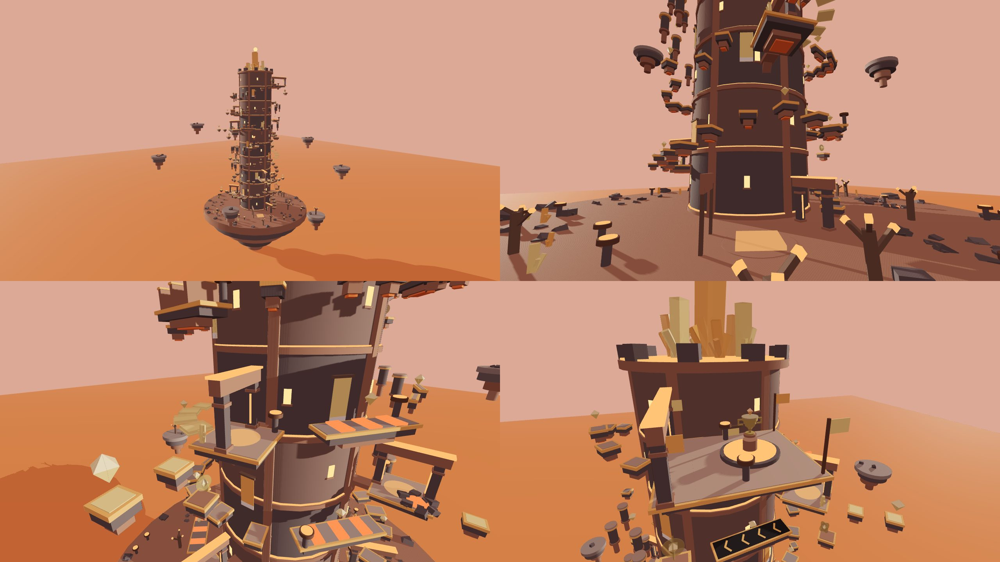

# Roblox : des jeux créés à partir des tendances, testés automatiquement

**[La Fabrique](fabrique/README.md).** Elle lit les
classements Roblox, choisit un format de jeu qui monte et un thème, puis écrit
un jeu complet, construit, testé et validé. Un jeu de plus, en une commande :

```bash
./fabrique/nouveau-jeu.sh
```

## Les jeux

Six jeux, six thèmes, deux formats. Tous passent le pipeline sans erreur ni
avertissement ; les deux premiers ont aussi été testés dans le vrai moteur
Roblox (21 tests sur 21 chacun). Ils ont été repris après un premier essai en
jeu du propriétaire : vrais sauts, lumière plus nette, gemmes et coupe
modélisées, chute qui ramène à la dernière borne, reliques secrètes, record.

| Jeu | Format | Thème | Pièces | Gemmes et reliques atteignables | |
|---|---|---|---|---|---|
| 🚨 [Escape The Prison Run](jeux/evasion-prison.md) | Évasion | prison | 2997 | 49 / 49 | [aperçu](jeux/apercus/evasion-prison.jpg) · [rapport](reports/evasion-prison.md) |
| 🌋 [Tower Of Volcano](jeux/tour-volcan.md) | Tour | volcan | 2283 | 49 / 49 | [aperçu](jeux/apercus/tour-volcan.jpg) · [rapport](reports/tour-volcan.md) |
| 🌃 [Night City Escape Obby](jeux/evasion-neon.md) | Évasion | neon | 2475 | 49 / 49 | [aperçu](jeux/apercus/evasion-neon.jpg) · [rapport](reports/evasion-neon.md) |
| 🌴 [Ruins Prison Run](jeux/evasion-jungle.md) | Évasion | jungle | 3150 | 49 / 49 | [aperçu](jeux/apercus/evasion-jungle.jpg) · [rapport](reports/evasion-jungle.md) |
| 🧊 [Tower Of Ice](jeux/tour-glace.md) | Tour | glace | 2358 | 49 / 49 | [aperçu](jeux/apercus/tour-glace.jpg) · [rapport](reports/tour-glace.md) |
| 🍭 [Escape The Candy Run](jeux/evasion-bonbon.md) | Évasion | bonbon | 2831 | 49 / 49 | [aperçu](jeux/apercus/evasion-bonbon.jpg) · [rapport](reports/evasion-bonbon.md) |



_Aperçu approximatif (dessiné hors de Roblox) : le rendu réel, avec les
matériaux et les lumières de Roblox, se voit dans Roblox Studio._

Ce dont le projet a besoin de votre part est réuni dans un seul document :
[`BESOINS.md`](BESOINS.md).

## Le dépôt

| Dossier / fichier | Contenu |
|---|---|
| [`fabrique/`](fabrique/) | La Fabrique : choix d'après les tendances, thèmes, obstacles, script de jeu, aperçu ([mode d'emploi](fabrique/README.md)) |
| [`jeux/`](jeux/) | Fiche et aperçu de chaque jeu créé, catalogue |
| [`src/`](src/) | Noyau commun à tous les jeux : sauvegarde (avec verrou de session), récompense quotidienne, achats, boutique, interface |
| [`maps/`](maps/) | Scripts de construction des jeux (à coller dans la barre de commande de Roblox Studio, ou à construire avec le pipeline) |
| [`pipeline/`](pipeline/) | Chaîne automatique : construction hors Studio, tests, rapport de validation ([mode d'emploi](pipeline/README.md)) |
| [`reports/`](reports/) | Derniers rapports de validation de chaque jeu, et des tests dans le vrai moteur Roblox |
| [`recherche/`](recherche/) | Recherche de niche à partir des classements officiels Roblox ([dernier rapport](recherche/rapport-niche.md)) |
| [`PROJECT.md`](PROJECT.md), [`DECISIONS.md`](DECISIONS.md), [`PROGRESS.md`](PROGRESS.md) | Suivi du projet : ce qu'on construit, les décisions, ce qui est fait |
| [`prompt-map-roblox.md`](prompt-map-roblox.md) | Prompt d'origine pour générer une map |

Lancer tous les tests :

```bash
./pipeline/run.sh
```

Créer la boutique, publier la place et la tester dans le vrai moteur Roblox
(clé dans `ROBLOX_API_KEY`, détails dans [`pipeline/README.md`](pipeline/README.md)) :

```bash
python3 pipeline/opencloud.py boutique
```

```bash
python3 pipeline/opencloud.py publier build/iles-celestes.rbxl
```

```bash
python3 pipeline/opencloud.py tester
```

Nouvelle photo des classements Roblox + rapport de niche :

```bash
python3 recherche/niche.py
```

## Autre map : L'Île d'Auraciel (`ile-auraciel.lua`)

Script autonome à coller dans la barre de commande de Roblox Studio. Il n'est
pas (encore) construit ni validé par le pipeline, qui ne traite que `maps/`.

**Thème choisi : île flottante fantasy au crépuscule doré** — cascades qui tombent dans le
vide, arbre-cristal géant, village de lanternes, ruines célestes et secrets à découvrir.

Le script complet est dans [`ile-auraciel.lua`](ile-auraciel.lua) (le prompt qui a servi de
cahier des charges est dans [`prompt-map-roblox.md`](prompt-map-roblox.md)).

### Mode d'emploi

1. Ouvre Roblox Studio dans une place (Baseplate ou vide).
2. Affiche la barre de commande : **View → Command Bar**.
3. Colle tout le contenu de `ile-auraciel.lua` et appuie sur **Entrée**.
4. Attends quelques secondes : l'île, le lighting et le script de jeu s'installent seuls.
5. Appuie sur **▶ Play** : leaderboard, collecte d'Éclats, animations et secrets sont actifs.

### Ce qui t'attend sur l'île

| | Zone | Ambiance |
|---|---|---|
| 🚪 | **Belvédère de l'Aube** | le spawn, face à l'arbre-cristal et au soleil couchant |
| 🏘️ | **Hameau des Lucioles** | maisons à colombages, auberge, puits aux vœux, étals |
| 💠 | **Bosquet d'Auréline** | le pied d'Yggdraluma, menhirs runiques, cristaux sauvages |
| 🌊 | **Lagon du Voile** | lagon turquoise, ponton, passerelle et cascade dans le vide |
| 🏛️ | **Ruines de l'Ordre Céleste** | temple brisé, marches volantes, la Couronne à 58 studs |
| 🌙 | **2 zones secrètes** | des lucioles bleutées marquent l'entrée des passages cachés… |

La boucle de jeu : ~50 **Éclats d'Auréline** (rotation, son, particules, respawn) comptés
dans le leaderboard, des éclats dorés **×5** dans les zones secrètes, et un unique
**Éclat Prismatique ×25** posé sur son piédestal.

Tout se règle dans la table `CONFIG` en tête de script : taille de l'île, graine aléatoire,
nombre d'éclats, palette, heure du jour, densité du décor, préréglage `mobile / normale / ultra`.
Le script est re-exécutable : le relancer reconstruit l'île proprement. Aucun asset payant ni
ID externe — uniquement des textures et sons intégrés à Roblox (`rbxasset://`).

### 3 pistes pour la suite

1. **Quêtes du Hameau** : un PNJ devant l'auberge qui demande « rapporte-moi 10 Éclats » puis
   « trouve la Grotte de Lune », avec un coffre de récompense qui s'ouvre au retour — la
   structure de tags (`IF_Collectible`, `IF_Secret`) est déjà prête pour brancher ces objectifs.
2. **Cycle jour/nuit lent** (10 minutes réelles) : la nuit, les lanternes brillent plus fort,
   les champignons s'illuminent davantage et un événement rare apparaît — une *pluie
   d'étoiles filantes* qui fait tomber des Éclats bonus pendant 60 secondes.
3. **Récompenses quotidiennes et streaks** : un autel au sanctuaire qui offre un multiplicateur
   d'Éclats chaque jour de connexion consécutif, sauvegardé en DataStore — la raison n°1 de
   revenir demain.
